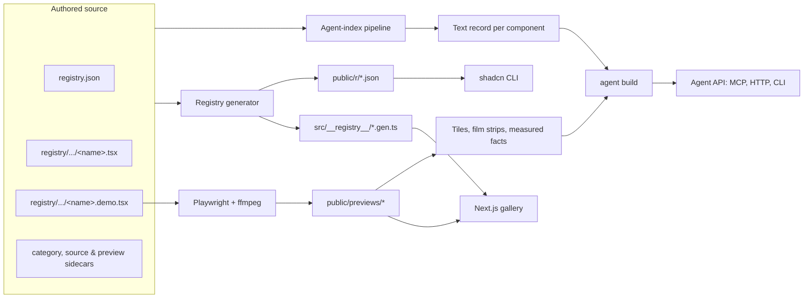

<div align="center">

# StashUI

**The agentic UI library. Curated React components your agent can see, choose from and install.**

Browse, preview, copy, and install shadcn-style components, or let an AI agent
look at the same library as numbered images and pick for you.

[](https://stashui.vercel.app/)
[](https://stashui.vercel.app/)
[](https://nextjs.org/)
[](https://react.dev/)
[](#use-stashui-with-an-ai-agent)
[](LICENSE)

[Explore the gallery](https://stashui.vercel.app/) ·
[Install a component](#install-a-component) ·
[Connect an agent](#use-stashui-with-an-ai-agent) ·
[Understand the architecture](#architecture)

</div>

---

StashUI is an open component library built for two kinds of discovery:

- **Humans** use the StashUI gallery to browse categories, search with
  <kbd>⌘ K</kbd>, watch lightweight previews, inspect live components, copy
  source, and get an install command.
- **Agents** ask in words and get back one image: a numbered grid of real
  components. They choose by looking, check their picks side by side, and
  install a whole screen in one command.

The components follow the shadcn model: source code is installed into your
project and becomes yours to edit. StashUI is a registry and discovery system,
not a runtime UI package.

## Start here

| I want to… | Go to |
| --- | --- |
| Browse the catalogue | [Open the live gallery](https://stashui.vercel.app/) |
| Add one component to my app | [Install a component](#install-a-component) |
| Run or contribute to StashUI | [Run the gallery locally](#run-the-gallery-locally) |
| Let an agent choose components | [Give your agent one prompt](#use-stashui-with-an-ai-agent) |
| Understand how data is generated | [Read the architecture](#architecture) |
| Add a registry component | [Follow the contributor workflow](#add-or-update-a-component) |

## Why StashUI?

- **A large, organized catalogue:** 790 curated components across 31 practical
  categories, from buttons and forms to backgrounds, effects, navigation, and
  data display.
- **Real previews:** fast video loops in the gallery and live, responsive,
  interactive previews on every component page.
- **One-command installation:** install through the shadcn CLI, including npm
  packages, registry dependencies, CSS variables, and keyframes declared by the
  component.
- **Framework-conscious source:** the registry records React and Next.js
  compatibility and warns when a component introduces a Next-only import.
- **Agents that can see:** search returns a composed image of the matching
  components, so an agent judges look and fit the way a person does.
- **Inspectable generation:** the gallery, installable JSON, previews, and
  agent index all trace back to files committed in this repository.

## Install a component

### 1. Prepare a shadcn project

Use an existing shadcn project, or initialize one first:

```bash
npx shadcn@latest init
```

### 2. Pick and install

Browse [stashui.vercel.app](https://stashui.vercel.app/), open a component, and
copy its install command. For example:

```bash
npx shadcn@latest add https://stashui.vercel.app/r/shimmer-button.json
```

The CLI writes the component into your configured components directory and
installs anything declared by its registry item.

### 3. Import it

```tsx
import { ShimmerButton } from "@/components/ui/shimmer-button";

export function SaveAction() {
  return <ShimmerButton>Save changes</ShimmerButton>;
}
```

> [!TIP]
> You can pass several registry URLs to one `shadcn add` command. The
> agent `add` operation prepares that combined command automatically and
> includes the shadcn primitives the selected components import.

## Run the gallery locally

### Requirements

- [Node.js](https://nodejs.org/) 20 or newer
- npm
- Python 3 when rebuilding the agent index
- Optional: Playwright and `ffmpeg` when recording preview videos

### Setup

```bash
git clone https://github.com/vermarjun/StashUI.git
cd StashUI
npm install
npm run dev
```

Open [http://localhost:3000](http://localhost:3000). No environment variables
are required for the gallery or MCP server.

### Useful commands

| Command | Purpose |
| --- | --- |
| `npm run dev` | Start the Next.js development server |
| `npm run build` | Create a production gallery build |
| `npm run start` | Serve the production build |
| `npm run lint` | Run ESLint |
| `npm run typecheck` | Run TypeScript without emitting files |
| `npm run registry` | Rebuild gallery data, installable JSON, and the agent index |
| `npm run index` | Rebuild only the agent index |
| `npm run agent` | Rebuild everything agents are served (`public/agent/`) |
| `npm run agent:test` | Test the agent API, CLI, MCP endpoint and skills |
| `npm run agent:dev` | Serve the agent API alone on port 4317 |
| `npm run capture -- <name>` | Record one component's grid preview |
| `npm run capture:category -- <slug>` | Record every preview in a category |
| `npm run previews` | Regenerate the preview manifest |

## Use StashUI with an AI agent

Paste this into Claude Code, Codex, Cursor or any coding agent with a shell:

> Set up StashUI for me: follow https://stashui.vermarjun.xyz/setup.md

The agent runs one command, the same on macOS, Linux and Windows. It installs a one-file CLI and three skills
into your home folder; nothing in your project changes, and there is no account
or key. From then on, ask for UI the way you normally would:

> Build the landing page: header, hero, features and pricing. Dark and calm.

What the agent does with that:

1. **Reads the project**: stack, design tokens, components already installed.
   It writes a `DESIGN.md` if there is none.
2. **Looks at the catalogue.** `stashui browse` and `stashui search` return one
   image each: a numbered grid of real components, cropped so each is legible,
   plus one line per number with what it does and what it costs to adopt.
3. **Looks closer.** `stashui view <name>` returns six frames of a component in
   motion, so hover and click behaviour is visible in a still image.
4. **Checks the set.** `stashui board` puts all its picks in one image, to see
   whether they look like one product.
5. **Builds and verifies.** `stashui add` installs through shadcn;
   `stashui review` returns counts that have to reach zero. It reports each
   pick with its runner-up.

Ask for a mockup first ("show me a mockup before you build") and the agent
runs `stashui propose` instead: a link showing each pick as a live clip beside
its runners-up, where you swap what you dislike and approve.

Agents with no shell (Claude Desktop, claude.ai, ChatGPT) add
`https://stashui.vermarjun.xyz/api/mcp` as a remote MCP server instead. It has
no login and offers the same six operations with the images inline.

| Door | Address |
| --- | --- |
| Setup document | `/setup.md` |
| CLI (one file, no dependencies) | `/agent/stashui.mjs` |
| MCP server (Streamable HTTP, stateless) | `/api/mcp` |
| HTTP API, self-describing | `/api/agent/v1` |
| Whole catalogue as JSON | `/agent/catalog.json` |
| Skills index | `/.well-known/agent-skills/index.json` |

[agent/README.md](agent/README.md) explains how this is built and why each
decision was made. [agent/SPEC.md](agent/SPEC.md) is the protocol.

## Architecture

There is one authored source of truth. Everything used by the gallery, shadcn,
and agents is generated from it.



### Project layers

| Layer | Location | Responsibility |
| --- | --- | --- |
| Component source | `registry.json`, `registry/` | Components, demos, dependencies, categories, attribution, and preview configuration |
| Registry generation | `scripts/build-registry.mjs` | Validates portability and generates gallery-safe data |
| Install registry | `public/r/*.json` | Static shadcn registry items consumed by `shadcn add` |
| Human experience | `src/app/`, `src/components/site/` | Search, category browsing, detail pages, code display, and responsive previews |
| Preview pipeline | `scripts/capture*.mjs`, `scripts/captures/` | Records interaction choreography and emits optimized grid media |
| Agent index | `agent-index/` | Builds a validated text record per component |
| Agent protocol | `agent/` | Turns clips into images an agent can read, ranks, composes sheets, and serves them over MCP, HTTP and a CLI |

### Generated files

Do not edit these by hand:

```text
src/__registry__/registry.gen.ts   full source and demo code; server-only
src/__registry__/meta.gen.ts       lightweight client-safe catalogue
src/__registry__/demos.gen.ts      component name → lazy demo component
src/__registry__/previews.gen.ts   client-safe preview manifest
public/r/*.json                    installable shadcn registry items
agent-index/index/                 text records the agent build reads
public/agent/                      everything agents are served (catalogue, CLI, skills)
```

## Preview system

The project intentionally uses two different preview modes:

- **Explore cards** show muted, looped, accelerated video. An intersection
  observer only plays visible clips. Components without a usable capture fall
  back to a live iframe.
- **Detail pages** render the real interactive demo inside a fixed preview box.
  Mobile, tablet, and desktop controls change the iframe viewport so the
  component reflows normally instead of being transform-scaled.

Optional per-component files tune the experience:

```text
registry/<category>/<name>.preview.json   frame, device, scroll, and capture settings
scripts/captures/<name>.mjs               Playwright interaction choreography
```

To record one preview, keep the dev server running in one terminal:

```bash
npm run dev
```

Then run in another:

```bash
npm run capture -- shimmer-button
npm run previews
```

Preview capture requires `ffmpeg` and Playwright's Chromium browser. Install the
browser once with `npx playwright install chromium`.

## Add or update a component

1. Add the component and its real usage demo:

   ```text
   registry/buttons/my-component.tsx
   registry/buttons/my-component.demo.tsx
   ```

2. Add one item to `registry.json` with its name, title, description, files,
   npm dependencies, registry dependencies, and any CSS or CSS variables.
3. Add or update its category in `registry/categories.json`. Attribution and
   display-title overrides live in `registry/sources.json` and
   `registry/titles.json` when needed.
4. Optionally add a `.preview.json` sidecar and capture choreography.
5. Rebuild all derived data:

   ```bash
   npm run registry
   ```

6. Verify the project:

   ```bash
   npm run lint
   npm run typecheck
   npm run build
   ```

### Component portability rules

Registry components must work in plain React/Vite and Next.js:

- Import only `@/lib/utils`, shadcn primitives, and declared npm dependencies.
- Do not import from `next/*`; use Radix's `asChild` pattern for links and plain
  `` elements for images.
- Keep `"use client"` when hooks or state require it; it is harmless outside
  Next.js.
- Read `window` and `document` only inside effects or behind a mounted guard.
- Prefer theme tokens such as `bg-background`, `text-muted-foreground`, and
  `border-border` over hardcoded colors.
- Declare required keyframes and theme variables in the component's
  `registry.json` item so installed code is self-contained.

The registry generator scans imports and reports framework compatibility
warnings during `npm run registry`.

## Repository map

```text
StashUI/
├── registry.json              shadcn registry manifest
├── registry/                  component source, demos, and sidecars
├── src/                       Next.js gallery
│   └── __registry__/          generated gallery modules
├── public/r/                  generated installable registry items
├── public/previews/           generated grid videos and posters
├── scripts/                   registry and preview tooling
├── agent-index/               text record per component, and its pipeline
└── agent/                     the agent protocol: core, CLI, skills, pipeline
```

Three skills ship with the agent protocol and are installed by the setup
prompt: [`stashui`](agent/skills/stashui/SKILL.md) builds UI from the catalogue,
[`stashui-explore`](agent/skills/stashui-explore/SKILL.md) offers visual
directions to choose from, and
[`stashui-review`](agent/skills/stashui-review/SKILL.md) audits existing UI.

## Contributing

Issues and pull requests are welcome. For component changes, include a demo that
shows real content and interactions, not an empty `<Component />` placeholder.
Keep generated files in sync and run the verification commands before opening a
pull request.

When importing work from another component library, record its provenance in
`registry/sources.json`; the gallery uses that metadata to credit the source.

## Deployment

The gallery is a standard Next.js app and can be deployed to Vercel. After
deployment, each generated registry item is available at:

```text
https://<your-domain>/r/<component-name>.json
```

Those public URLs are what make `npx shadcn@latest add ...` work for other
projects.

## Documentation

- [Agent protocol: how it works and why](agent/README.md)
- [Agent protocol: the specification](agent/SPEC.md)
- [Agent-index design](agent-index/README.md)
- [Index schema and field ownership](agent-index/spec/SCHEMA.md)
- [Index generation contract](agent-index/spec/PROMPT.md)

## Acknowledgements

StashUI builds on [shadcn](https://ui.shadcn.com/), React, Next.js, Tailwind CSS,
Radix UI, and the many component authors credited by the gallery's source
metadata.

## License

StashUI is available under the [MIT License](LICENSE).

---

<sub>Documentation last reviewed: 2026-09-07.</sub>
